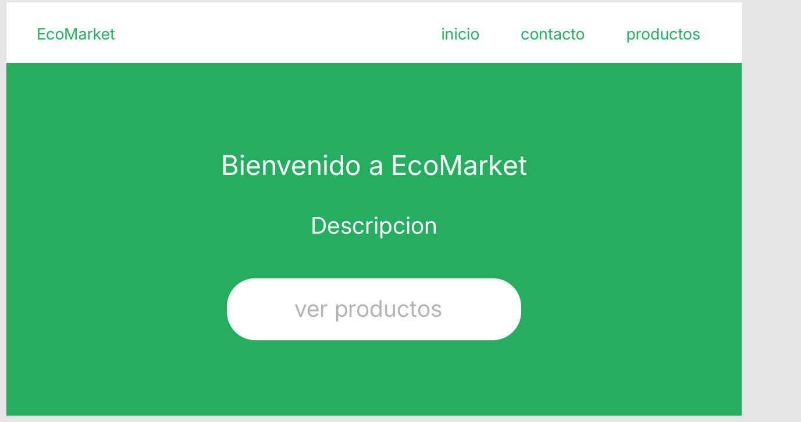
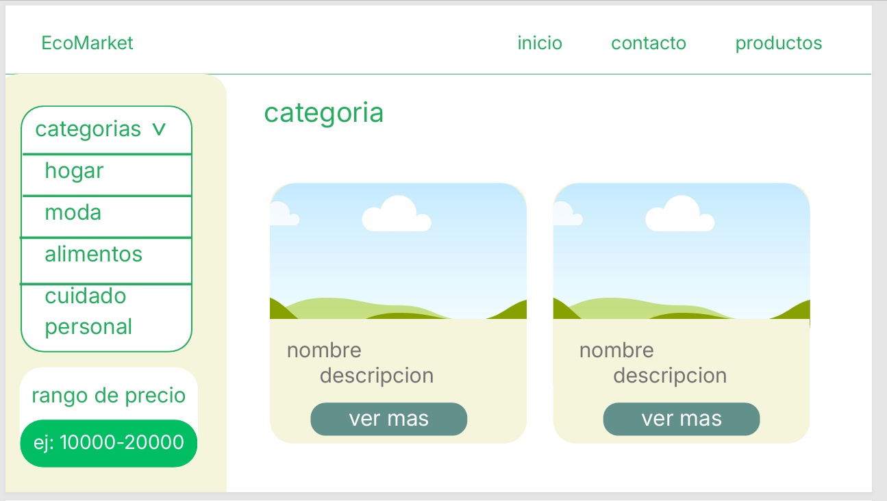
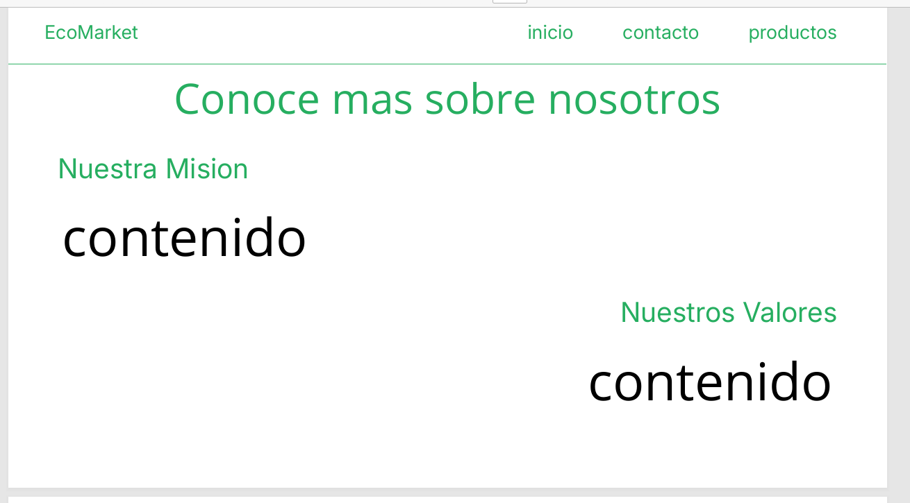
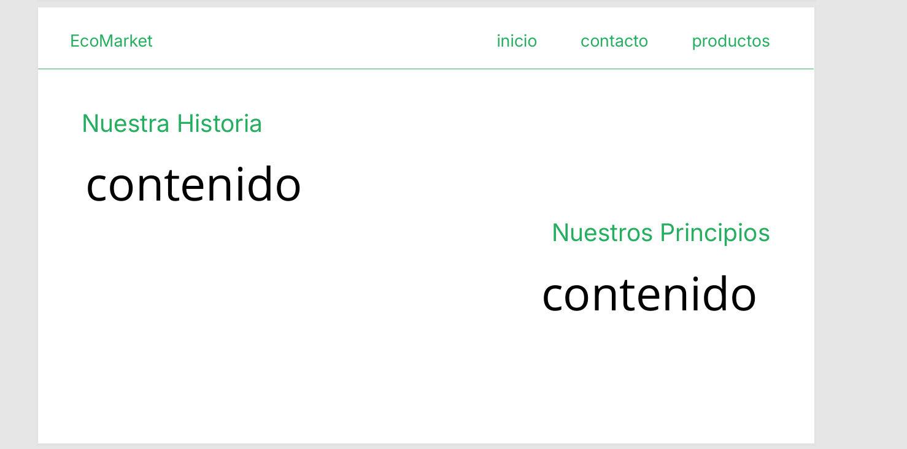
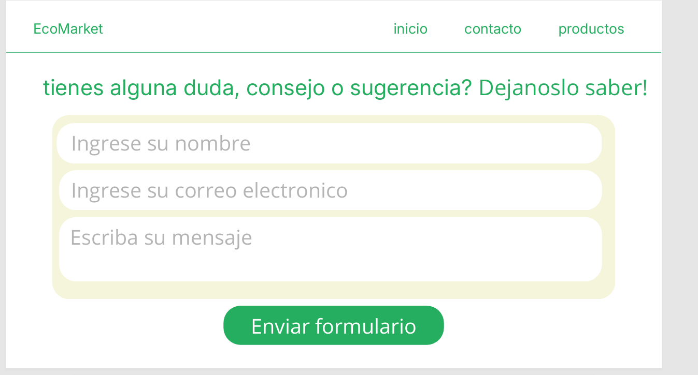
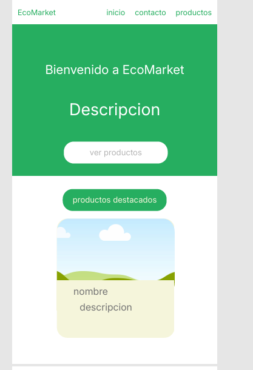
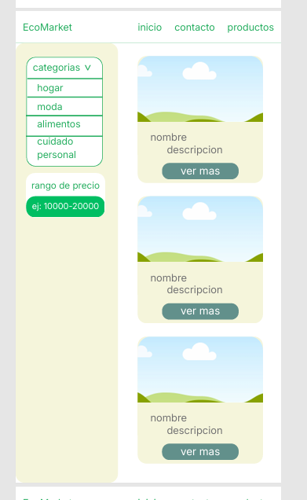
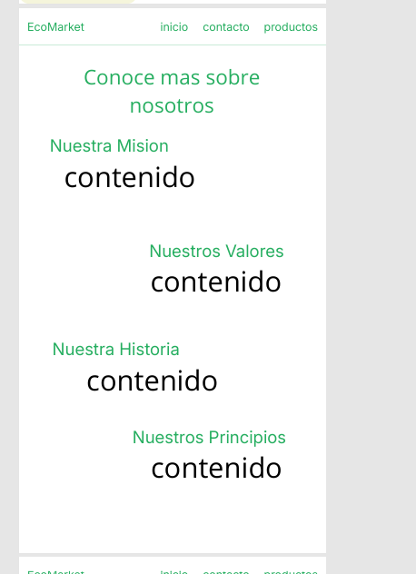
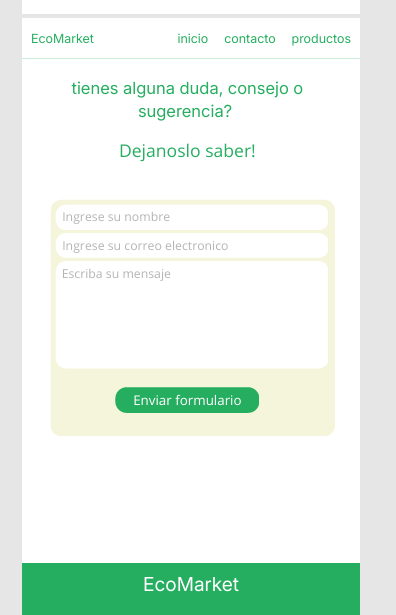

# EcoMarket_DavidLopez# EcoMarket

## Descripción del Proyecto
EcoMarket es una tienda en línea dedicada a la venta de productos ecológicos, reutilizables y sustentables. El proyecto fue desarrollado aplicando un enfoque "Clean", utilizando HTML5 semántico y CSS3 puro sin el uso de frameworks ni JavaScript, garantizando una interfaz responsiva, accesible y optimizada bajo la metodología Mobile First.

## Instrucciones de Visualización
 entrar al siguiente link para ver la pagina web 
 ecomarketdavidlopez.vercel.app

## Tecnologías Utilizadas
* **HTML5:** Estructuración semántica y formularios con validación nativa.
* **CSS3:** 
  * Custom Properties (Variables)
  * Flexbox & CSS Grid
  * Pseudo-clases y pseudo-elementos (`:hover`, `:active`, `:checked`, `:valid`, `:invalid`)
  * Scroll Snap (para carrusel sin JS)
  * Media Queries (Enfoque Mobile First)
* **Git y GitHub:** Control de versiones usando GitFlow y Conventional Commits.

## mockups de la pagina
### Vista de Escritorio

### Vista Móvil

## capturas finales de la pagina

